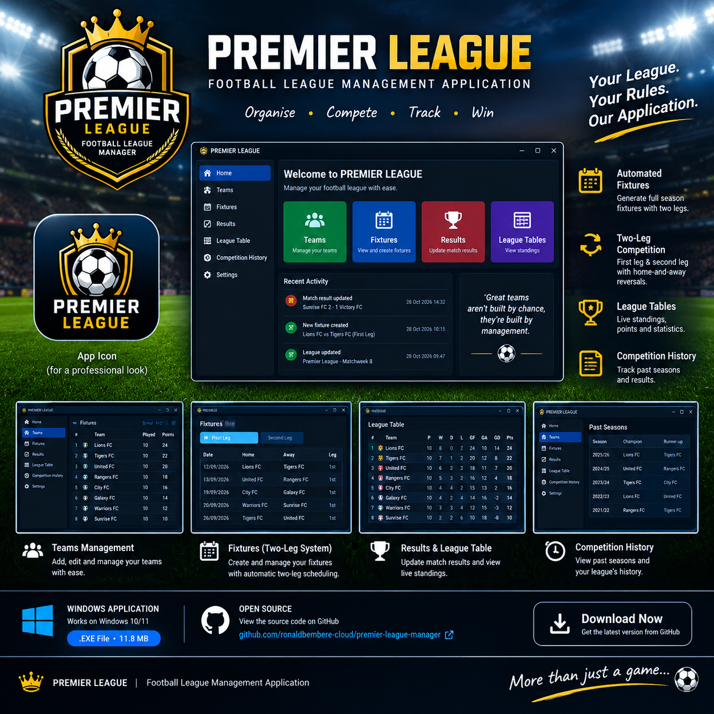

# ⚽ PREMIER LEAGUE

### Football League Management Application

**Organise. Compete. Track. Win.**

[**⬇️ DOWNLOAD FOR WINDOWS**](https://github.com/ronaldbembere-cloud/premier-league-manager/releases/latest)

[Features](#-features) · [Installation](#-installation) · [How It Works](#-how-it-works)

---

## 🏆 About PREMIER LEAGUE

**PREMIER LEAGUE** is a Windows desktop application designed to help you organise and manage your own football league.

Whether you're organising a local football competition, managing a school league, or creating your own football tournament, PREMIER LEAGUE helps you keep everything organised in one place.

## ✨ Features

* **👥 Team Management** — Register and manage participating teams.
* **📅 Automated Fixtures** — Generate league fixtures automatically.
* **🔄 Two-Leg Competition** — Organise first-leg and second-leg matches with home-and-away reversals.
* **⚽ Match Results** — Record match results and track league progress.
* **🏆 League Tables** — View standings and team performance.
* **📚 Competition History** — Keep track of previous seasons and results.

## 💻 Installation

1. Visit the [latest PREMIER LEAGUE release](https://github.com/ronaldbembere-cloud/premier-league-manager/releases/latest).
2. Under **Assets**, download `PREMIER.LEAGUE.TWO.LEGS.exe`.
3. Save the downloaded file to a suitable folder on your Windows computer.
4. Open the application and follow any Windows security prompts carefully.

**System:** Windows desktop application.

> **Security note:** Download the application only from the official project release. Windows may display a warning because the executable is not widely recognised or digitally signed. Do not bypass a warning unless you trust the file and have verified its source.

## ⚙️ How It Works

1. Register the teams participating in your competition.
2. Generate the fixtures.
3. Play and record the matches.
4. Review the league table.
5. Keep track of your competition's history.

## 📥 Download

Ready to organise your football competition?

### ⚽ Your League. Your Rules. Your Application.

[**DOWNLOAD PREMIER LEAGUE**](https://github.com/ronaldbembere-cloud/premier-league-manager/releases/latest)

## 🛠️ Project Information

* **Application:** PREMIER LEAGUE
* **Version:** 1.0.0
* **Platform:** Windows desktop
* **Release:** [View releases on GitHub](https://github.com/ronaldbembere-cloud/premier-league-manager/releases)

## 💬 Feedback

Found a problem or have an idea for a future feature? Open an issue in this repository and describe what you would like improved.

---

**PREMIER LEAGUE** ⚽

*Making football league management easier.*

